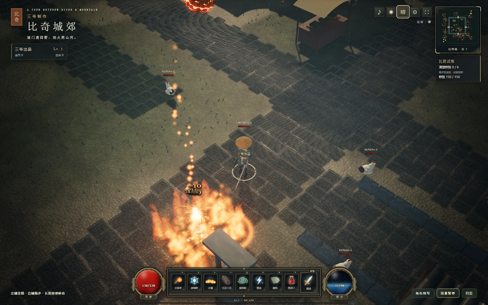
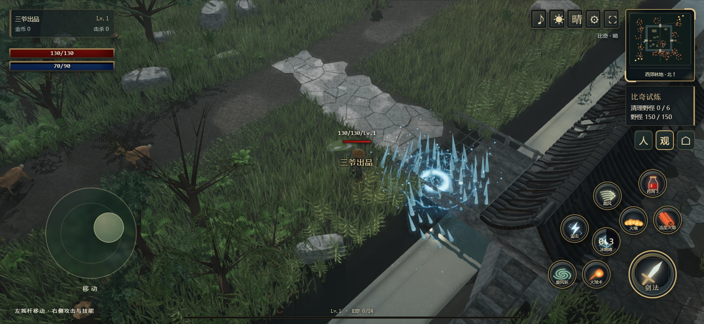
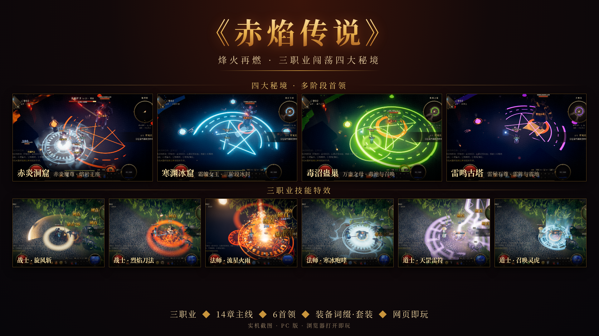
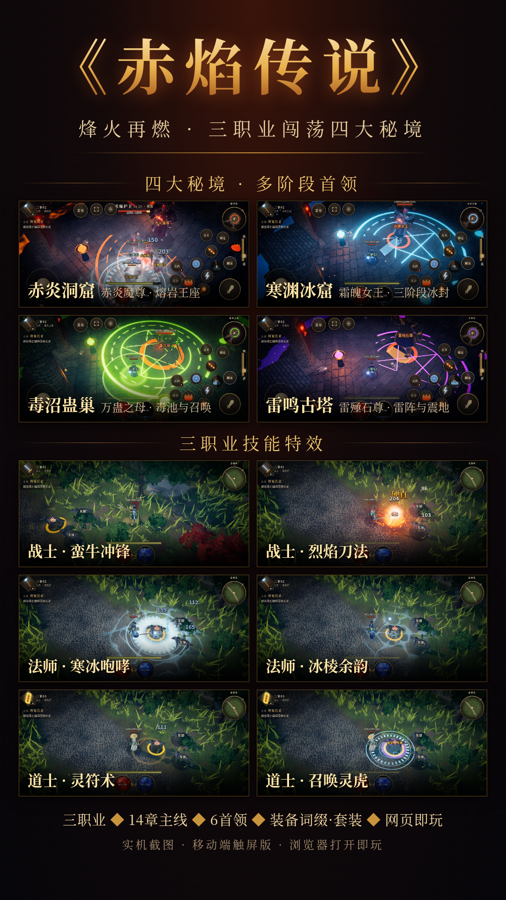

# 三爷制作 · Dark Legend

两款可在浏览器中直接游玩的单文件 3D 动作 RPG，支持电脑与手机，也可下载对应 HTML 离线体验。

## 试玩入口

| 游戏 | 内容 | 在线试玩 | 离线版本 |
|---|---|---|---|
| 比奇城郊 | 斗笠剑客、城郊探索与打怪升级 | [开始试玩](https://newgame007.github.io/Dark-Legend/game.html) | [game.html](game.html) |
| 赤焰传说 | 战士、法师、道士，四大秘境与首领挑战 | [开始试玩](https://newgame007.github.io/Dark-Legend/cycs.html) | [cycs.html](cycs.html) |

## 第一款 · 比奇城郊

**比奇城郊 · 单文件程序化古风动作 RPG**

一款以传奇风格城镇与荒野为灵感的离线单机动作小游戏。戴上斗笠、提起长剑，在城镇与郊野之间探索，施展剑法与元素技能，击败野怪并提升等级。

地图、角色、怪物、材质、动画、技能特效与声音均由程序生成，连同运行库封装在约 **444 KiB** 的单个 HTML 文件中。支持电脑键鼠和手机触屏，不需要额外下载模型、贴图或音频，也不依赖 CDN 或游戏服务器。

**[▶ 在线游玩](https://newgame007.github.io/Dark-Legend/game.html)** · [查看 / 下载离线版 HTML](game.html)

在线入口由 GitHub Pages 提供，也可下载单个 HTML 离线游玩。

### 游戏截图

#### 电脑端

固定 45° 视角下的林地、密草、护城河与石桥，以及火墙与流星火雨的战斗特效。



#### 手机端 · 横屏

左侧跟手摇杆、右侧攻击与环绕技能按钮，支持同时移动和施法。图中展示冰咆哮效果。



以上截图均来自本仓库 `game.html` 的实际运行。手机图使用浏览器触屏模拟，展示横屏移动端界面。

### 游戏特色

- **城镇与郊野探索**：城墙、四座城门、护城河、石桥、王宫院落、商铺街与周围荒野构成可探索地图。
- **地貌与植被**：起伏丘陵、断崖、低谷与群落地被，混生阔叶、松树、枯树、白桦、橡树和垂柳。
- **打怪升级**：击杀获取经验与金币，升级提高属性；支持药剂、死亡回城复活，以及怪物在远处补刷。怪物也会随玩家等级成长。
- **六类怪物**：鸡、鹿、稻草人、半兽人、红野猪、白野猪，总计 150 个怪物槽位。六只精英白野猪拥有范围攻击与独立讨伐计数。
- **三段近战连招**：横斩、反手斩、重劈，普通攻击无额外冷却，支持近战寻敌和长按衔接。
- **七种主动技能**：火球术、冰咆哮、九宫格火墙、流星火雨、旋风斩、雷击与踏风冲刺；旋风斩支持移动释放。踏风冷却 0.5 秒，其余主动技能冷却 1 秒。
- **地形阻挡与绕行**：建筑、树干、石块与河流参与碰撞；移动支持自动绕障，冲刺与弹道也会受到阻挡。遮住玩家的建筑、树干与树叶渐变为 65% 不透明，离开后恢复。
- **动态天气与光影**：晴、雨、雷雨、雾渐变切换，雨滴触地溅水、水面涟漪，配合阴影、反射、泛光与暗色氛围效果。
- **程序化声音**：本地合成雨、风、流水、雷声、脚步、怪物、挥剑、命中和技能等音效，支持距离衰减与左右声像。
- **电脑与手机独立 UI**：电脑使用键鼠与底部技能栏；手机使用跟手摇杆、环绕技能按钮和拖拽瞄准，支持多点触摸。
- **可调视野与画质**：固定 45° 角度，战斗视野可在 8～30 之间调整；提供低、中、高三档画质，默认高画质，三档均以 60 帧为目标。

### 开始游玩

1. 点击上方 **“▶ 在线游玩”**，或下载本仓库中的 **`game.html`** 离线运行。
2. 使用支持 **WebGL 2** 和 **DecompressionStream** 的现代浏览器，建议使用新版 Chrome 或 Edge。离线游玩时用浏览器打开下载的 HTML。
3. 点击“开始历练”进入游戏。声音在首次交互后启用，开始时会请求全屏；不支持全屏时仍可在浏览器窗口内游玩。

手机建议横屏操作，并使用能执行网页脚本的浏览器打开。文件管理器中的文档预览可能无法运行游戏。

只复制 `game.html` 即可离线游玩，`screenshots` 目录仅供本 README 展示图片。

### 操作说明

| 操作 | 电脑 | 手机 |
|---|---|---|
| 走路 | 左键点击地面，按住持续移动 | 轻推左侧摇杆 |
| 跑步 | 右键点击地面，按住持续移动 | 大幅推动摇杆 |
| 键盘移动 | WASD / 方向键，Shift 跑步 | — |
| 选怪与追击 | 点击野怪 | 点击野怪 |
| 三段剑法 | 点按或长按空格 | 点按或长按攻击按钮 |
| 火球 / 冰咆哮 / 火墙 / 流星火雨 | `1` / `2` / `3` / `4` | 按住技能拖拽瞄准，松手释放 |
| 旋风斩 / 雷击 / 踏风 | `Q` / `E` / `R` | 对应技能按钮 |
| 使用药剂 | `F` | 药剂按钮 |
| 取消施法 | — | 拖到取消区域后松手 |
| 暂停 | Escape / 观景暂停 | 观景暂停 |
| 视野与画质 | 右上角齿轮设置 | 右上角齿轮设置 |
| 天气 / 声音 / 全屏 | 右上角对应按钮 | 右上角对应按钮 |

### 技术实现

采用 **JavaScript、Three.js r180、WebGL 2、Canvas 程序纹理和 Web Audio**。发布脚本先做轻度标识符混淆，再使用内联 gzip 打包，由浏览器本地解压加载。

场景使用空间裁剪、共享几何、静态矩阵冻结、粒子池与按需更新，减少重复计算和内存分配。实际帧率和耗电取决于设备、浏览器、画质设置与场景负载。

这是离线单机演示，等级、经验与金币保存在当前页面内存中，刷新页面后重新开始。

## 第二款 · 赤焰传说

**烽火再燃 · 三职业闯荡四大秘境**

从青石镇出发，选择战士、法师或道士，探索荒野与地下秘境。完成主线任务，收集装备与套装，挑战拥有阶段变化和不同招式的首领。

**[▶ 试玩《赤焰传说》](https://newgame007.github.io/Dark-Legend/cycs.html)** · [查看 / 下载离线版 HTML](cycs.html)

单个 HTML 约 **449 KiB**，支持电脑键鼠与手机触屏。下载后使用现代浏览器打开，即可离线体验。

### 游戏特色

- **三种职业**：战士重甲近战，法师使用火、雷、冰法术，道士擅长符箓、治愈、施毒与召唤。
- **四大秘境**：赤炎洞窟、寒渊冰窟、毒沼蛊巢、雷鸣古塔，各有不同环境、敌人与首领战。
- **14章主线**：从镇外历练逐步深入秘境，完成讨伐任务并领取经验、金币和装备奖励。
- **首领阶段变化**：生命下降时切换招式、召唤援军或强化攻击，战斗包含范围预警与不同机制。
- **装备与套装**：打怪获取装备，搭配职业属性与套装效果，逐步提升角色能力。
- **战斗操作**：支持连击、翻滚、格挡与弹反，三种职业有各自的技能表现。
- **本地存档**：提供存档槽和自动保存，进度保存在当前浏览器本地，不跨设备同步。

### 电脑端展示

四大秘境的首领战，以及三种职业的技能效果。



### 移动端展示

触屏摇杆、攻击与技能按钮，以及秘境战斗和职业技能展示。下图为竖版宣传图，展示图中的移动端游戏画面。



### 开始游玩

1. 点击上方 **“▶ 试玩《赤焰传说》”**，或下载 **cycs.html** 后用浏览器打开。
2. 创建或选择本地存档，选择职业进入游戏。
3. 电脑端可用鼠标点击地面或 WASD 移动，按 H 查看操作指南；手机使用触屏摇杆与技能按钮。

存档依赖浏览器本地存储。清理浏览器数据、更换浏览器或设备后，原有本地进度不会自动转移。

## 文件说明

```text
Dark-Legend/
├── game.html                   # 第一款：比奇城郊
├── cycs.html                   # 第二款：赤焰传说
├── README.md                   # 两款游戏介绍与试玩入口
└── screenshots/
    ├── desktop.webp            # 比奇城郊电脑端截图
    ├── mobile-landscape.webp   # 比奇城郊手机横屏截图
    ├── cycs-desktop.png         # 赤焰传说电脑端宣传图
    └── cycs-mobile.png          # 赤焰传说移动端宣传图
```

离线游玩只需下载对应的 HTML 文件；screenshots 目录仅用于本页展示。两款 HTML 均内嵌运行库，并保留 Three.js MIT 许可证说明。
